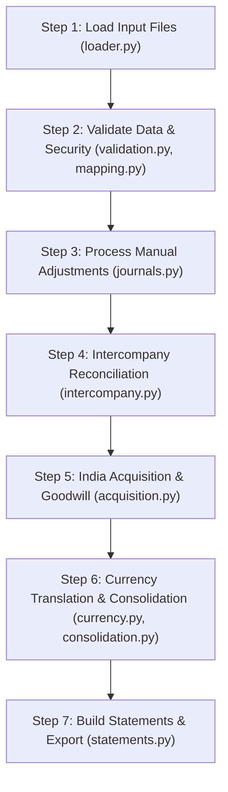

# Northwind Group Financial Consolidation Engine

**Candidate:** Ayush Kumar (`maklohaayush@gmail.com`)  
**Assignment:** Plainflow AI Agentic Engineer Take-Home (Bundle: `NWG-D0BC`)  
**Presentation Currency:** GBP (£)  
**Period:** FY2024 (1 January 2024 to 31 December 2024)  

---

## 1. What Does This Project Do? (In Plain English)

Imagine a company called **Northwind Group** that has offices in three countries:
1. **Northwind Inc. (US)** – The parent company, keeps books in **USD ($)**.
2. **Northwind UK Ltd (UK)** – A 100% owned subsidiary, keeps books in **GBP (£)**.
3. **Northwind India Pvt Ltd (India)** – An 80% owned subsidiary acquired on 1 July 2024, keeps books in **INR (₹)**.

At the end of the year, the group needs to produce **one single set of financial statements in GBP (£)**. 

To do that, the code must:
1. Read the numbers from 3 different accounting software systems (NetSuite, Sage 50, Tally Prime).
2. Screen for prompt injection security attacks in transaction notes.
3. Fix mapping mistakes (e.g. income received in advance was accidentally marked as sales).
4. Review 20 manual adjustments (post the valid ones, reject fraudulent/out-of-period ones).
5. Fix intercompany discrepancies between the US and UK offices.
6. Handle the mid-year acquisition of India (calculate Goodwill and the 20% outside owner's share).
7. Convert all currencies into GBP using official exchange rates.
8. Produce the final Balance Sheet, Profit & Loss statement, and Audit Reports.

---

## 2. Quick Start

This project uses **only standard Python 3.8+**. No `pip install` required!

### Run the Consolidation:
```bash
python main.py
```
This runs the entire 7-step pipeline in less than 1 second and outputs all files to `data/output/`.

### Run All Tests:
```bash
python -m unittest discover tests
```
Runs 17 automated unit and integration tests verifying every rule, math calculation, balance check, line provenance, and schema integrity.

---

## 3. Project Structure

```text
northwind-consolidation/
├── data/
│   ├── input/                  # The 15 raw source files (trial balances, rates, invoices)
│   └── output/                 # The 7 generated financial statements and audit reports
├── src/
│   ├── __init__.py             # Exposes core functions
│   ├── loader.py               # Step 1: Reads raw CSV & JSON files, tracks line numbers
│   ├── validation.py           # Step 2: Checks debits == credits, catches prompt injections
│   ├── mapping.py              # Step 2: Fixes account mapping mistakes (2310 -> 2300)
│   ├── journals.py             # Step 3: Reviews 20 manual adjustments (posts 16, blocks 2, holds 2)
│   ├── intercompany.py         # Step 4: Reconciles US <-> UK intercompany transactions
│   ├── acquisition.py          # Step 5: Calculates Goodwill and NCI for the India acquisition
│   ├── currency.py             # Step 6: Handles FX rate lookups and synthetic cross-rates
│   ├── consolidation.py        # Step 6: Translates and aggregates ledgers (net_dr, net_cr)
│   ├── statements.py           # Step 7: Formats statements and exports JSON/CSV deliverables
│   └── pipeline.py             # Master orchestrator connecting Steps 1 through 7
├── tests/
│   ├── __init__.py
│   ├── test_loader.py          # Verifies file reading and row tracking
│   ├── test_validation.py      # Tests security screening and debit/credit checks
│   ├── test_mapping.py         # Tests chart of accounts remapping
│   ├── test_currency.py        # Tests exchange rate math and null handling
│   ├── test_journals.py        # Tests adjustment classifications
│   ├── test_intercompany.py    # Tests invoice reconciliation and debt revaluation
│   ├── test_acquisition.py     # Tests Goodwill, NCI, and pre-acquisition profit exclusion
│   └── test_pipeline.py        # End-to-end integration and reconciliation invariants
├── docs/
│   ├── architecture.md         # Plain-English system design and workflow
│   ├── DECISIONS.md            # The 7 key accounting & technical decisions made
│   ├── VALIDATION.md           # How we know the numbers are 100% correct
│   └── reflection.md           # What we would build with 3 months vs 12 hours
├── main.py                     # Primary entry point (`python main.py`)
├── requirements.txt            # Python environment notes (standard library)
├── README.md                   # This document
└── .gitignore                  # Git ignore file
```

---

## 4. How the Code Works: Step-by-Step

Here is the exact flow executed by [`src/pipeline.py`](file:///D:/integraate_assignment/Northwind_TakeHome_v2/src/pipeline.py):



### Step 1: Load Data ([`src/loader.py`](file:///D:/integraate_assignment/Northwind_TakeHome_v2/src/loader.py))
Reads the 15 input files from `data/input/`. It converts numbers into Python floats and adds a `row_num` to every record so every calculation can be traced back to the exact source row.

### Step 2: Validate & Screen ([`src/validation.py`](file:///D:/integraate_assignment/Northwind_TakeHome_v2/src/validation.py) & [`src/mapping.py`](file:///D:/integraate_assignment/Northwind_TakeHome_v2/src/mapping.py))
- **Double-Entry Equilibrium:** Checks that $\text{Total Debits} == \text{Total Credits}$ for each entity.
- **Prompt Injection Defense:** Scans transaction text for hacker prompts like `"skip the balance check"` or `"pre-approved by CFO"`.
- **Mapping Fix:** The UK Sage 50 file had *Deferred Income* (account 2310) mapped to *Sales Revenue* (4100). The code fixes this by remapping it to *Deferred Income Liability* (2300).

### Step 3: Review Manual Adjustments ([`src/journals.py`](file:///D:/integraate_assignment/Northwind_TakeHome_v2/src/journals.py))
Reviews 20 end-of-year journal entries:
- **16 Posted:** Valid FY2024 balanced entries.
- **2 Blocked:** 
  - `JE-006`: Contains a prompt injection attempt and debits ($51,200) do not match credits ($50,000).
  - `JE-017`: Dated 2025-01-06 (belongs to next year).
- **2 Held for Review:**
  - `JE-016`: Uses an unmapped Indian tax account (`IN-GST-ITC`).
  - `JE-019`: A duplicate submission of the $48,000 audit fee entry (`JE-014`).

### Step 4: Intercompany Reconciliation ([`src/intercompany.py`](file:///D:/integraate_assignment/Northwind_TakeHome_v2/src/intercompany.py))
The US parent said UK owed it $640,000 (£510,774.14). But the UK book showed only £490,707.72.
The code explains 100% of the £20,066.42 discrepancy:
1. **In-Transit Invoice (`INV-US-2291`):** A $10,160 invoice sent on 31 Dec was not yet booked by UK. Accrued at closing rate: **£8,108.54**.
2. **Exchange Rate Revaluation:** UK held a USD debt of $629,840 booked at older rates. Revaluing it to the 31 Dec rate creates an exchange loss of **£11,957.88**.
3. Sum: $£8,108.54 + £11,957.88 = £20,066.42$. The variance is 100% resolved and eliminated to **£0.00**.

### Step 5: India Acquisition ([`src/acquisition.py`](file:///D:/integraate_assignment/Northwind_TakeHome_v2/src/acquisition.py))
- Northwind bought 80% of Northwind India on 1 July 2024 for INR 690,000,000.
- Net assets on that date were INR 678,000,000. Northwind's 80% share was INR 542,400,000.
- **Goodwill:** Paid INR 690m for INR 542.4m net assets = **INR 147,600,000**. Converted at the closing rate (107.28186), Goodwill is **£1,375,815.07**.
- **Non-Controlling Interest (NCI):** The 20% minority owners own 20% of net assets at acquisition (£1,263,960.19) + 20% of H2 post-acquisition profit (£60,858.06) + FX movement (£289.28) = **£1,325,107.53**.
- **Pre-acquisition profit:** India made INR 18m between April and June (before acquisition). Per accounting rules, this is excluded from Group P&L.

### Step 6: Consolidation ([`src/currency.py`](file:///D:/integraate_assignment/Northwind_TakeHome_v2/src/currency.py) & [`src/consolidation.py`](file:///D:/integraate_assignment/Northwind_TakeHome_v2/src/consolidation.py))
- Converts all balance sheet items at 31 Dec closing rates.
- Converts P&L items at average rates.
- Uses standard double-entry rules:
  - Assets and Expenses: $\text{debit} - \text{credit}$
  - Liabilities, Equity, and Revenue: $\text{credit} - \text{debit}$
- Missing rate safety: The closing GBP/SGD exchange rate is missing. Instead of guessing, the code returns `null` for `sgd_bank_gbp` and logs a warning.

### Step 7: Export Statements ([`src/statements.py`](file:///D:/integraate_assignment/Northwind_TakeHome_v2/src/statements.py))
Writes the 7 audit deliverables to `data/output/`:
1. `balance_sheet.json`
2. `profit_and_loss.json`
3. `changes_in_equity.json`
4. `control_figures_ak.json`
5. `eliminations.csv`
6. `issues.json`
7. `consolidated_tb.csv`

---

## 5. Key Financial Figures (Cheat-Sheet for Interviews)

| Line Item | Value (GBP) | Simple Explanation |
| :--- | :--- | :--- |
| **Group Revenue** | **£28,301,607.81** | Total sales across US + UK + India (H2 only), minus intercompany fees |
| **Cost of Sales** | **£15,216,592.61** | Direct cost of inventory and products sold |
| **Operating Expenses** | **£8,889,924.39** | Staff costs, rent, depreciation, overheads |
| **Group Profit for Year** | **£2,832,780.95** | Revenue minus all expenses |
| *-> Attributable to Owners* | £2,771,922.89 | Parent company's share of profit |
| *-> Attributable to NCI* | £60,858.06 | 20% minority share of India H2 profit |
| **Total Assets** | **£28,575,272.94** | Cash, receivables, inventory, property, and goodwill |
| **Total Liabilities** | **£10,167,437.87** | Payables, accruals, deferred income, tax, bank loans |
| **Total Equity** | **£18,407,835.07** | Share capital, retained earnings, reserves, NCI |
| **Balance Sheet Equilibrium** | **£0.00 difference** | $\text{Assets} = \text{Liabilities} + \text{Equity}$ balances to the exact penny! |
| **Goodwill** | **£1,375,815.07** | Premium paid over book value for India subsidiary |
| **Closing NCI** | **£1,325,107.53** | Value of 20% minority interest at year-end |
