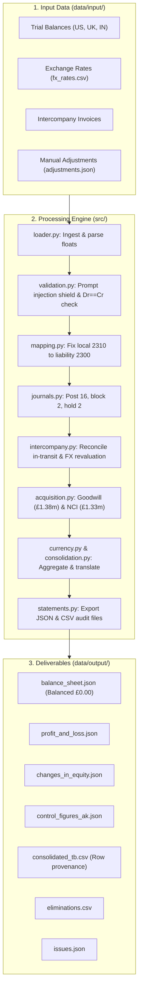

# System Architecture (docs/architecture.md)

This document explains how the consolidation engine is built, why it is designed this way, and how to explain it in an interview.

---

## 1. What is Financial Consolidation in Software Terms?

From a Computer Science perspective, financial consolidation is essentially a **Distributed Data Reconciliation and Pipeline ETL problem**:

1. **Extraction:** Multiple subsidiary databases (US NetSuite, UK Sage, India Tally) export trial balance snapshots with different schemas, local account codes, and currencies.
2. **Sanitization:** Input data contains formatting issues, local mapping bugs, missing exchange rates, and adversarial text entries.
3. **Transformation:**
   - **Bilateral Matching:** Reconciling intercompany accounts and eliminating internal transactions so group sales are not counted twice.
   - **M&A Business Combinations:** Computing Goodwill and Non-Controlling Interest (NCI) for acquired subsidiaries.
   - **Currency Translation:** Converting foreign balances into presentation currency (GBP) using closing rates for balance sheet items and average rates for P&L items.
4. **Loading & Reporting:** Generating verified, balanced financial statements (Balance Sheet, P&L, Equity Roll-Forward) with transparent, row-level audit lineage.

---

## 2. Core Architectural Principles

### Principle 1: Deterministic Math vs. AI Reasoning
**Never let an LLM do financial arithmetic.** LLMs are probabilistic token predictors; they can hallucinate numbers, make rounding errors, and be fooled by adversarial prompts.

- **Deterministic Code (Python Standard Library):**
  - All financial math, currency translations, and balance checks run in pure, predictable Python.
  - Double-entry verification: $\text{Debits} == \text{Credits}$.
  - The fundamental accounting invariant: $\text{Assets} == \text{Liabilities} + \text{Equity}$.
  - Zero external packages or runtime API dependencies required.
- **Role of AI in the Workflow:**
  - AI tools (like Claude/ChatGPT/Gemini) are helpful during the development loop for code scaffolding, research, and drafting explanations.
  - At runtime, however, the financial engine is 100% deterministic code. An auditor must know that rerunning the code on identical inputs will produce the exact same numbers down to the penny every single time.

### Principle 2: Simple, Flat Data Structures
Instead of complicated Object-Oriented hierarchies (e.g. `AbstractAccountFactory`, `CurrencyVisitor`, `EntityNodeComposite`), we use standard, transparent Python data structures:
- Each row is a plain Python dictionary: `{"account_code": "1100", "debit": 4875000.0, "row_num": 2}`.
- Every function is small (under 60 lines), stateless, and independently testable.
- Line numbers (`row_num`) are preserved at ingestion so every number in the final reports can be traced back to the exact CSV line.

---

## 3. The 7-Step Pipeline Architecture

The pipeline ([`src/pipeline.py`](file:///D:/integraate_assignment/Northwind_TakeHome_v2/src/pipeline.py)) executes in a strict sequential order:

---

## 4. Module Responsibilities at a Glance

| Module | What It Does | Why It Is Important |
| :--- | :--- | :--- |
| **`src/loader.py`** | Reads CSV/JSON files, converts strings to floats, attaches line numbers | Ensures all downstream calculations have clean float data and exact row tracking |
| **`src/validation.py`** | Scans memos for prompt injections, validates trial balance balance | Protects the system against malicious inputs and invalid ERP records |
| **`src/mapping.py`** | Fixes UK account 2310 mapping from 4100 to 2300 | Prevents deferred revenue from overstating sales by £180,000 |
| **`src/currency.py`** | Finds rates, computes cross-rates, flags missing SGD rate | Performs multi-currency conversions per IAS 21 policies |
| **`src/journals.py`** | Evaluates the 20 manual journals against rules | Rejects out-of-period or unbalanced entries before they touch ledgers |
| **`src/intercompany.py`** | Reconciles US <-> UK balances and accrued invoices | Completely eliminates £20,066.42 discrepancy to £0.00 |
| **`src/acquisition.py`** | Calculates Goodwill and Non-Controlling Interest (NCI) | Implements IFRS 3 acquisition accounting for 80% India stake |
| **`src/consolidation.py`** | Aggregates all accounts using double-entry net balances | Translates subsidiary balances and sums group totals |
| **`src/statements.py`** | Formats final JSON reports and CSV audit files | Produces final deliverables required by auditors and CFO |
| **`src/pipeline.py`** | Connects all steps into one executable script | Coordinates the end-to-end consolidation workflow |
